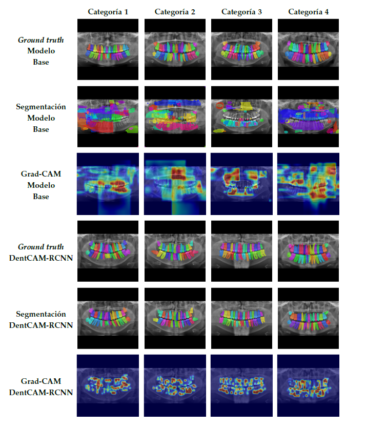
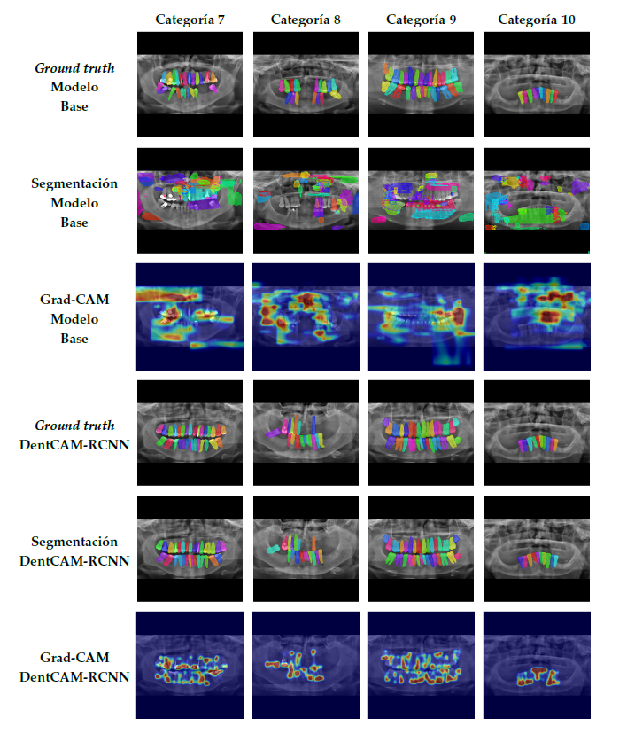
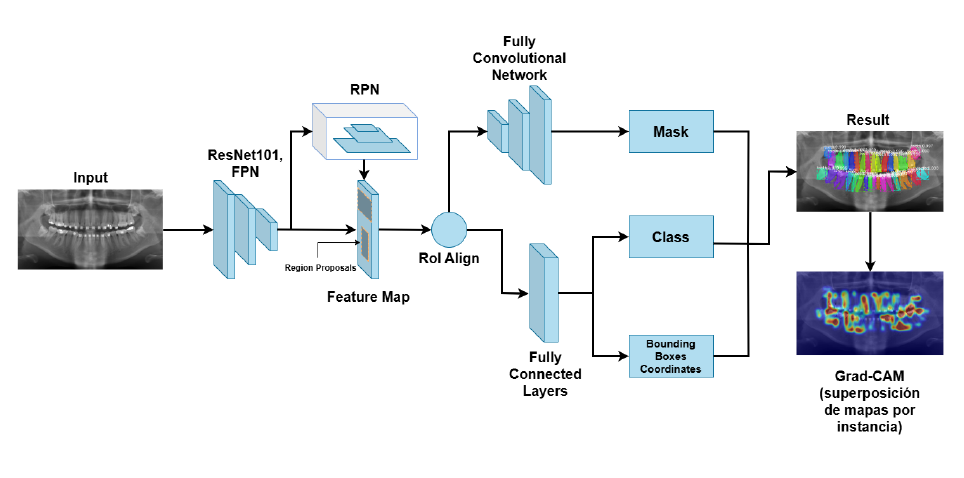
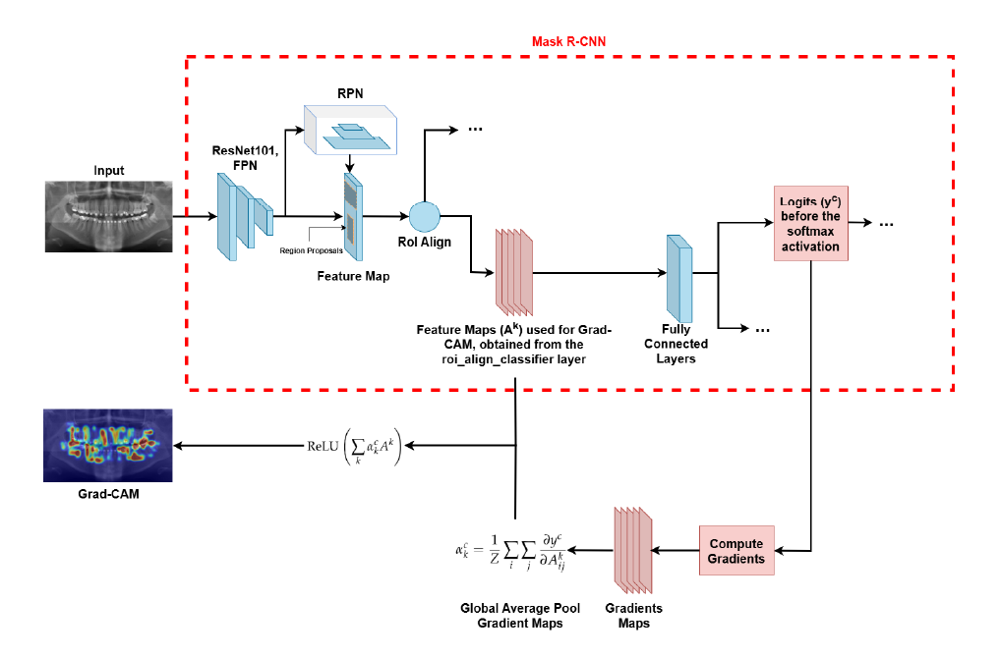

# Mathematical Analysis of Convolutional Neural Networks and Explainable Instance Segmentation

**Bachelor's Thesis · Joint Bachelor's Degree in Computer Science and Engineering and Mathematics · University of Granada · June 2025**  
**Final grade: 9.54/10 in both degrees**

[**Thesis (PDF)**](docs/bachelors_thesis.pdf) · [**Presentation (PDF)**](docs/thesis_presentation.pdf) · [**Implementation notebook**](dentcam_rcnn.ipynb) · [**Citation**](CITATION.cff)

> **How can mathematical understanding of convolutional networks complement accurate and explainable instance segmentation?**
>
> This joint thesis combines a **theoretical analysis of deep convolutional feature extractors** with **DentCAM-RCNN**, a Mask R-CNN adaptation for individual tooth segmentation in panoramic dental radiographs. The practical component incorporates Grad-CAM to analyze instance-level predictions and evaluates detection, segmentation, and explanation quality.

**Keywords:** Convolutional Neural Networks, Mathematical Modeling, Wavelets, Computer Vision, Deep Learning, Instance Segmentation, Explainable Artificial Intelligence, Grad-CAM.

## At a glance

- **Academic scope:** one joint thesis spanning Computer Science and Engineering and Mathematics.
- **Mathematical foundations:** Mallat's scattering-network analysis and the general framework of Wiatowski and Bölcskei, including semi-discrete frames, Lipschitz-continuous nonlinearities, and pooling operators.
- **Application:** instance segmentation of teeth in panoramic dental radiographs.
- **Model:** COCO-pretrained Mask R-CNN with a ResNet-101 backbone and Feature Pyramid Network (FPN), fine-tuned for the dental domain.
- **Explainability:** instance-level Grad-CAM adapted to the `roi_align_classifier` representation.
- **Evaluation:** detection (precision, recall, F1-score, AP@50), segmentation (DSC, IoU, Hausdorff distance), and explanation quality (deletion, insertion, stability, and Grad-CAM overlap).

## Key results

The DentCAM-RCNN implementation achieved the following results on the thesis test set:

| Evaluation area | Metric | Test-set result |
| --- | --- | ---: |
| Detection | F1-score | **96.04%** |
| Detection | Precision | **97.36%** |
| Segmentation | Dice similarity coefficient (DSC) | **87.76%** |
| Segmentation | Intersection over Union (IoU) | **79.23%** |

The study also reports category-wise detection, segmentation, and explainability metrics, as well as comparisons against the original baseline model and classical unsupervised segmentation methods. See the [full thesis](docs/bachelors_thesis.pdf) for the complete experimental results and comparison protocol.

**Interpretation:** the reported results support the effectiveness of the domain-adapted model **on the dataset and evaluation protocol used in this thesis**. They do not establish clinical suitability or generalization to unseen hospitals, imaging devices, or patient populations.

### Qualitative visualizations

The following examples compare segmentation predictions and Grad-CAM explanations from the baseline and DentCAM-RCNN.

| Dental categories 1–4 | Dental categories 7–10 |
| --- | --- |
|  |  |

## Methodology

### Part I — Mathematical analysis of CNNs

The theoretical component extends the analysis of scattering networks introduced by Mallat through the framework developed by Wiatowski and Bölcskei. It studies deep convolutional feature extractors built from:

- **General semi-discrete frames** and associated convolutional filters.
- **Lipschitz-continuous activation functions** and pooling operators.
- **Feature representations under spatial translations**, including the vertical translation-invariance properties derived under the framework's assumptions.

This analysis provides a mathematical perspective on why feature representations may become increasingly robust to spatial displacements with network depth. The precise hypotheses, definitions, and proofs are documented in the [thesis](docs/bachelors_thesis.pdf).

### Part II — DentCAM-RCNN

**Instance segmentation.** DentCAM-RCNN adapts a COCO-pretrained **Mask R-CNN** to panoramic dental radiographs. The architecture uses a **ResNet-101 + FPN** feature extractor, a Region Proposal Network (RPN), RoI alignment, and separate branches for classification, bounding-box regression, and instance masks. The model is fine-tuned for the dental domain.



**Explainability.** Following the instance-level adaptations discussed by **Inbaraj et al.**, the implementation applies **Grad-CAM** to individual predictions, using features associated with `roi_align_classifier` and per-instance class scores to produce attribution heatmaps. The explanations are examined visually and evaluated quantitatively using deletion, insertion, stability, and overlap-based measurements.



**Evaluation.** The experimental study analyzes detection, instance segmentation, and explanation quality across dental categories, comparing the adapted approach with the baseline and classical unsupervised methods. The reported metrics and experimental design are documented in the [full thesis](docs/bachelors_thesis.pdf).

## Repository structure

```text
.
├── docs/                         # Thesis documents
│   ├── bachelors_thesis.pdf      # Joint Bachelor's Thesis
│   └── thesis_presentation.pdf   # Defense slides
├── img/                          # Architecture, explanation, and result figures
├── mrcnn/                        # Adapted Mask R-CNN implementation (MIT-origin code)
├── dentcam_rcnn.ipynb            # Main implementation and experimental notebook
├── requirements.txt              # Recorded Python dependencies
├── README.md                     # Project overview and documentation
├── CITATION.cff                  # Machine-readable citation metadata
├── LICENSE                       # CC0-1.0 for eligible original contributions
└── LICENSE_MATTERPORT.txt        # Matterport MIT copyright and license notice
```

The notebook, model implementation, figures, and thesis documents are consolidated in this repository. The original research code is preserved rather than repackaged as a maintained software library. A local `dataset/` directory may be required by the notebook; **the public availability of medical-image data should not be assumed**.

## Setup and reproducibility

### Environment

The repository's recorded dependencies include:

| Component | Recorded version |
| --- | --- |
| TensorFlow | 2.14.0 (`tensorflow[and-cuda]`) |
| Keras | 2.14.0 |
| NumPy | 1.23.5 |
| OpenCV | 4.8.0.76 |
| scikit-image | 0.19.3 |

Clone the repository and prepare an appropriately compatible Python environment:

```bash
git clone https://github.com/juanmaarg6/TFG.git
cd TFG

python -m venv .venv
# Activate .venv using the command for your operating system.
pip install -r requirements.txt
```

**Compatibility note:** the pinned packages reflect the original research environment. A compatible Python version, operating system, CUDA setup, and additional configuration may be needed. This environment has **not been independently revalidated on a current system**, so the installation commands are not a guarantee of end-to-end reproducibility.

### Dataset, weights, and configuration

The notebook may depend on a locally available dental radiograph dataset, pretrained model weights, and machine-specific paths. Before execution:

- Obtain and organize the required dataset **only with the appropriate permissions**.
- Review the notebook's dataset paths and expected directory structure.
- Provide the required pretrained weights and adjust any local configuration.
- Check the compatibility of the TensorFlow/Keras environment and available GPU resources.

Medical images, model weights, and other third-party assets are **not automatically licensed for redistribution** by this repository. Ensure that any data used or shared are appropriately authorized and de-identified.

### Running the notebook

Open [`dentcam_rcnn.ipynb`](dentcam_rcnn.ipynb) in Jupyter Notebook, JupyterLab, or another compatible notebook environment. It contains the research workflow for model adaptation, segmentation, evaluation, and Grad-CAM visualization.

The original implementation has not been independently reproduced or validated as a clinical application. For the full experimental protocol, consult the [thesis](docs/bachelors_thesis.pdf).

## Author and acknowledgements

**Juan Manuel Rodríguez Gómez**  
Joint Bachelor's Degree in Computer Science and Engineering and Mathematics · University of Granada · 2025

This work draws on the mathematical contributions of **Stéphane Mallat** and **Wiatowski and Bölcskei**, the **Mask R-CNN implementation by Matterport, Inc.**, and the Grad-CAM methodology, including the instance-level adaptations discussed by Inbaraj et al. Third-party contributions remain attributed to their respective creators.

## Citation and license

If you use or reference this work, please cite the Bachelor's Thesis. Machine-readable citation metadata is available in [`CITATION.cff`](CITATION.cff).

This repository includes a [`CC0-1.0 license`](LICENSE) for **original contributions where the author has the rights to make that dedication**. The adapted code derived from **Matterport's Mask R-CNN** remains subject to the **MIT License** and its attribution requirements; see [`LICENSE_MATTERPORT.txt`](LICENSE_MATTERPORT.txt). Third-party datasets, imagery, weights, and dependencies may have separate restrictions and are **not covered automatically by CC0**.
